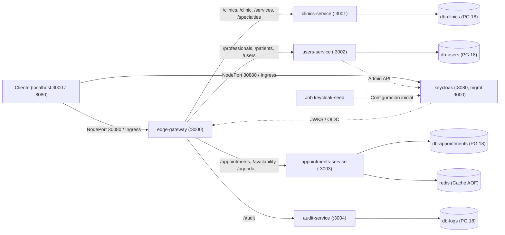

[English](README.md) · **Español**

# Despliegue en Kubernetes de MediCitas

Infraestructura de Kubernetes (base Kustomize + overlay local para Kind) y scripts multiplataforma para construir, desplegar y verificar toda la plataforma MediCitas localmente en **macOS**, **Linux** y **Windows**.

## Arquitectura



## Estructura de carpetas

```text
deploy/
├── .gitattributes                  # Fuerza LF en *.sh y CRLF en *.ps1 entre sistemas operativos
├── README.md / README.es.md        # Documentación del despliegue en Kubernetes (EN / ES)
├── docker/
│   └── assets.Dockerfile           # Imagen no-root que empaqueta database/ y keycloak/
├── kind/
│   └── kind-config.yaml            # Configuración de nodo Kind mapeando :3000/:8080/:80/:443
├── k8s/
│   ├── base/
│   │   ├── kustomization.yaml
│   │   ├── namespace.yaml          # Namespace medicitas (PodSecurity baseline/restricted)
│   │   ├── configmap-env.yaml      # Configuración no secreta del clúster
│   │   ├── network-policies.yaml   # Default-deny ingress + reglas explícitas por servicio
│   │   ├── ingress.yaml            # Ingress opcional por host (medicitas.local)
│   │   ├── databases/              # 4 StatefulSets PostgreSQL 18 aislados + PVCs
│   │   ├── redis/                  # StatefulSet Redis + PVC con contraseña y persistencia AOF
│   │   ├── keycloak/               # Deployment Keycloak + Job keycloak-seed
│   │   └── services/               # edge-gateway + 4 microservicios (Deployments, PDBs, HPAs)
│   └── overlays/
│       └── local/                  # Overlay Kind: NodePorts, ConfigMap/Secret, recursos locales
└── scripts/
    ├── deploy-local.sh             # Despliegue Bash multiplataforma (macOS / Linux / Git Bash & WSL)
    ├── deploy-local.ps1            # Despliegue nativo PowerShell en Windows
    ├── verify.sh                   # Verificación de pods y pruebas de humo multiplataforma
    ├── test-all-endpoints.mjs      # Suite E2E completa de 24 escenarios contra la API
    ├── teardown-local.sh           # Eliminación limpia del clúster (Bash)
    └── teardown-local.ps1          # Eliminación limpia del clúster (PowerShell)
```

## Buenas prácticas de Kubernetes aplicadas

| Práctica | Implementación |
| --- | --- |
| **Base de datos por microservicio** | StatefulSets y PVCs separados para `db-clinics`, `db-users`, `db-appointments` y `db-logs` (`postgres:18-alpine`, `PGDATA=/var/lib/postgresql/18/pgdata`). |
| **Mínimo privilegio y Pod Security** | El namespace aplica Pod Security `baseline` (`warn: restricted`). Todos los pods usan `runAsNonRoot: true`, `allowPrivilegeEscalation: false`, `capabilities.drop: ["ALL"]`, `seccompProfile: RuntimeDefault`; los servicios y Redis usan `readOnlyRootFilesystem: true`. |
| **Segmentación de red** | `network-policies.yaml` aplica `default-deny` en ingress dentro de `medicitas` y habilita únicamente el tráfico esperado entre gateway, microservicios, bases de datos, Redis y Keycloak. |
| **Arranque determinista** | Los servicios usan `initContainers` (`wait-for-deps`) para esperar a PostgreSQL, Redis o Keycloak antes de arrancar; las bases copian los esquemas SQL mediante `copy-init-sql` desde `medicitas/assets`. |
| **Salud y resiliencia** | Probes `startup`, `readiness` y `liveness` en cada carga (incluyendo el puerto de administración `9000` de Keycloak), `PodDisruptionBudget`, `HorizontalPodAutoscaler` y `topologySpreadConstraints`. |
| **Cero duplicación de SQL/Realm** | `deploy/docker/assets.Dockerfile` empaqueta `database/` y `keycloak/` directo desde la raíz del repo sin duplicar scripts ni realms. |
| **Iteraciones limpias** | `deploy-local.sh` y `deploy-local.ps1` eliminan cualquier clúster Kind previo llamado `medicitas` antes de crear uno nuevo para evitar conflictos de volúmenes, imágenes o puertos. |

## Prerrequisitos

Instale las siguientes herramientas y asegúrese de que Docker esté en ejecución:

- **Docker** (Docker Desktop en macOS/Windows, o Docker Engine/Desktop en Linux)
- **Kind** (`kind` CLI v0.20+)
- **kubectl** (con soporte integrado de `kubectl apply -k`)
- **Node.js 20+** (requerido para `test-all-endpoints.mjs` y cálculo portable de fechas en `verify.sh`)
- **curl** (usado por `verify.sh`)

> [!IMPORTANT]
> Libere los puertos locales **`3000`** y **`8080`** antes de desplegar (por ejemplo, detenga `docker compose` si está activo con `docker compose down`). Kind expone estos puertos del host directamente hacia los NodePorts del clúster.

## Inicio rápido (macOS, Linux, Windows)

Ejecute todos los comandos desde la **raíz del repositorio**.

### macOS y Linux

```bash
chmod +x deploy/scripts/*.sh
./deploy/scripts/deploy-local.sh
```

### Windows (Git Bash o WSL2)

Asegúrese de que Docker Desktop esté iniciado:

```bash
./deploy/scripts/deploy-local.sh
```

> `deploy-local.sh` exporta automáticamente `MSYS_NO_PATHCONV=1` para que Git Bash / MSYS2 en Windows no reescriba rutas internas de contenedores al ejecutar `docker` o `kubectl`, y usa comandos portables compatibles con `bash` 3.2+ de macOS.

### Windows (PowerShell nativo)

```powershell
.\deploy\scripts\deploy-local.ps1
```

Si PowerShell bloquea la ejecución de scripts en la sesión actual:

```powershell
Set-ExecutionPolicy -Scope Process -ExecutionPolicy Bypass
.\deploy\scripts\deploy-local.ps1
```

## Qué hace `deploy-local`

1. Verifica los CLI requeridos (`docker`, `kind`, `kubectl`) y comprueba que el daemon de Docker responda.
2. Elimina cualquier clúster Kind previo llamado `medicitas` (`kind delete cluster --name medicitas`) para garantizar una iteración limpia.
3. Crea un nuevo clúster Kind con `deploy/kind/kind-config.yaml`.
4. Construye las 6 imágenes locales:
   - `medicitas/assets:local`
   - `medicitas/edge-gateway:local`
   - `medicitas/clinics-service:local`
   - `medicitas/users-service:local`
   - `medicitas/appointments-service:local`
   - `medicitas/audit-service:local`
5. Carga las imágenes locales dentro del nodo Kind (`kind load docker-image`), e intenta precargar las imágenes base de Postgres/Redis/Keycloak si el almacenamiento de Docker local lo permite.
6. Aplica `deploy/k8s/overlays/local` mediante `kubectl apply -k`.
7. Espera a que estén listos los 4 StatefulSets de PostgreSQL, Redis, Keycloak, el Job `keycloak-seed` y los 5 Deployments de microservicios.

## Endpoints locales

| Componente | URL local | Mapeo en Kind |
| --- | --- | --- |
| **Edge Gateway (API)** | `http://localhost:3000` | Host `3000` → NodePort `30080` → `edge-gateway:3000` |
| **Salud del Gateway** | `http://localhost:3000/health` | Igual que arriba |
| **Keycloak** | `http://localhost:8080` | Host `8080` → NodePort `30880` → `keycloak:8080` |
| **OIDC Discovery** | `http://localhost:8080/realms/medicitas/.well-known/openid-configuration` | Igual que arriba |

Los nombres DNS internos permanecen aislados dentro del namespace `medicitas` (`clinics-service:3001`, `users-service:3002`, `appointments-service:3003`, `audit-service:3004`, `db-clinics:5432`, `db-users:5432`, `db-appointments:5432`, `db-logs:5432`, `redis:6379`, `keycloak:8080`).

## Verificación

### 1. Verificación de infraestructura y smoke test

```bash
./deploy/scripts/verify.sh
```

Valida:
- Estado de todos los pods en `medicitas` (`1/1 Running` y `keycloak-seed` `Completed`)
- `/health` del Gateway, configuración OIDC de Keycloak y rechazo `401` sin token
- Login contra Keycloak para usuarios de demo (`admin.sj` y `reception.sj`)
- RBAC y enrutamiento entre microservicios (`/audit/logs` `200`/`403`, `/services/:id`, `/professionals/:id` y `/availability`)
- Claves `avail:*` en la caché de Redis

### 2. Suite completa de pruebas E2E (24 suites)

```bash
node deploy/scripts/test-all-endpoints.mjs
```

Prueba todos los flujos de extremo a extremo contra `http://localhost:3000`: salud (externa y ClusterIP interna), catálogos públicos, tokens OIDC e incorporación de clínicas con Keycloak, CRUD de usuarios/profesionales/pacientes, horarios y bloqueos, caché de disponibilidad, reserva + conflictos/validación (`409`/`422`) + reprogramación/cancelación/resultado/notas, agendas/conteos y verificación de RBAC y outbox relay en `audit-service`.

> [!NOTE]
> `test-all-endpoints.mjs` crea usuarios, servicios, horarios y citas de prueba en el clúster. Ejecute `./deploy/scripts/deploy-local.sh` después si desea volver a un estado semilla limpio.

## Eliminación del clúster

Elimine el clúster local Kind y todos sus PVCs:

- **macOS / Linux / Git Bash / WSL**:
  ```bash
  ./deploy/scripts/teardown-local.sh
  ```
- **Windows PowerShell**:
  ```powershell
  .\deploy\scripts\teardown-local.ps1
  ```

## Solución de problemas

- **Puertos `3000` u `8080` ocupados**: Detenga procesos locales o `docker compose down` antes de ejecutar `deploy-local`.
- **Inspección de logs y pods**:
  ```bash
  kubectl -n medicitas get pods
  kubectl -n medicitas logs deploy/edge-gateway
  kubectl -n medicitas logs job/keycloak-seed
  ```
- **Fin de línea en Windows (errores `\r` en `.sh`)**: `deploy/.gitattributes` fuerza LF para `*.sh`. Si algún editor los convirtió a CRLF, restaure con `git checkout -- deploy/scripts/*.sh` o `dos2unix deploy/scripts/*.sh`.
- **Advertencias de `kind load` con imágenes multiplataforma**: `deploy-local` muestra avisos no fatales si Docker Desktop usa índices OCI para Postgres/Redis/Keycloak; Kind descarga esas imágenes base directamente si hace falta.
