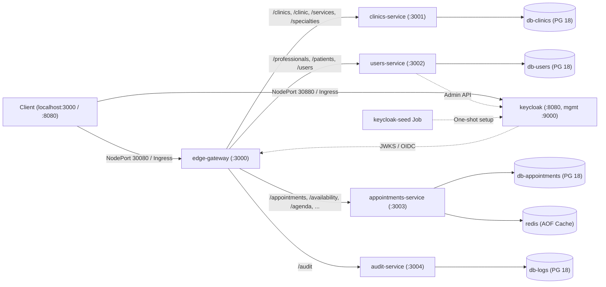

**English** · [Español](README.es.md)

# MediCitas Kubernetes Deployment

Optional local Kubernetes deployment using Kustomize and Kind, with Bash and
PowerShell scripts. Compose is the Stage 1 startup path. This review checked
manifests and script syntax; no cluster was deployed.

Deployment scripts delete the existing Kind cluster named `medicitas` by default,
including its data. Use only a disposable local cluster. `--keep-cluster` (Bash)
or `-KeepCluster` (PowerShell) reuses it and reapplies workloads; this is still a
mutation, not a read-only check.

## Architecture

The original diagram is retained. Its domain-service ports 3001-3004 and JWKS
arrow to the gateway are outdated: all domain services use internal port 3000,
and each domain service verifies tokens. Gateway prefixes have more specific
exceptions for schedules, assignments and patient history; see the [API](../docs/api.md).



## Directory Layout

```text
deploy/
├── .gitattributes                  # Enforces LF on *.sh and CRLF on *.ps1 across OSes
├── README.md / README.es.md        # Kubernetes deployment documentation (EN / ES)
├── docker/
│   └── assets.Dockerfile           # Non-root image packaging database/ and keycloak/ assets
├── kind/
│   └── kind-config.yaml            # Kind node config mapping host :3000/:8080/:80/:443
├── k8s/
│   ├── base/
│   │   ├── kustomization.yaml
│   │   ├── namespace.yaml          # medicitas namespace (PodSecurity baseline/restricted)
│   │   ├── configmap-env.yaml      # Non-secret cluster configuration
│   │   ├── network-policies.yaml   # Default-deny ingress + explicit allow rules
│   │   ├── ingress.yaml            # Optional host-based Ingress (medicitas.local)
│   │   ├── databases/              # 4 isolated PostgreSQL 18 StatefulSets + PVCs
│   │   ├── redis/                  # Redis StatefulSet + PVC with password & AOF persistence
│   │   ├── keycloak/               # Keycloak Deployment + keycloak-seed Job
│   │   └── services/               # edge-gateway + 4 microservices (Deployments, PDBs, HPAs)
│   └── overlays/
│       └── local/                  # Kind overlay: NodePorts, ConfigMap/Secret generators, sizing
└── scripts/
    ├── deploy-local.sh             # Cross-platform Bash deploy (macOS / Linux / Windows Git Bash & WSL)
    ├── deploy-local.ps1            # Native Windows PowerShell deploy
    ├── verify.sh                   # Cross-platform cluster & smoke verification
    ├── test-all-endpoints.mjs      # Full 24-suite end-to-end API verification script
    ├── teardown-local.sh           # Clean cluster deletion (Bash)
    └── teardown-local.ps1          # Clean cluster deletion (PowerShell)
```

## Declared Kubernetes configuration

| Practice | Implementation |
| --- | --- |
| **Database-per-service isolation** | Separate StatefulSets + PVCs for `db-clinics`, `db-users`, `db-appointments`, and `db-logs` (`postgres:18-alpine`, `PGDATA=/var/lib/postgresql/18/pgdata`). |
| **Least privilege & Pod Security** | Namespace enforces Pod Security `baseline` (`warn: restricted`). All pods set `runAsNonRoot: true`, `allowPrivilegeEscalation: false`, `capabilities.drop: ["ALL"]`, `seccompProfile: RuntimeDefault`; app services and Redis set `readOnlyRootFilesystem: true`. |
| **Network segmentation** | `network-policies.yaml` declares default-deny ingress with allow rules. Enforcement depends on the network plugin; deployment scripts do not install or verify a policy-enforcing plugin. |
| **Startup waits** | App services use `wait-for-deps` `initContainers` to wait for their PostgreSQL instance, Redis, or Keycloak before starting; databases copy SQL schemas via `copy-init-sql` from `medicitas/assets`. |
| **Health & resilience** | Startup/readiness/liveness probes on long-running workloads, PDBs, HPAs and topology spread settings. App `/health` probes only check liveness, not DB/identity/cache readiness. Jobs use completion status; HPA needs a metrics API. |
| **Zero duplication of SQL/Realm assets** | `deploy/docker/assets.Dockerfile` packages `database/` and `keycloak/` directly from repo root so manifests never duplicate schemas or realms. |
| **Clean iteration lifecycle** | `deploy-local.sh` and `deploy-local.ps1` delete any previous `medicitas` Kind cluster before creating a fresh cluster so stale PVCs, images, or ports never cause conflicts. |

## Prerequisites

Install the following tools and ensure Docker is running:

- **Docker** (Docker Desktop on macOS/Windows, or Docker Engine/Desktop on Linux)
- **Kind** (`kind` CLI v0.20+)
- **kubectl** (with built-in `kubectl kustomize` / `kubectl apply -k`)
- **Node.js >=22.18** (only needed to run `test-all-endpoints.mjs` or macOS/cross-platform date parsing in `verify.sh`)
- **curl** (for `verify.sh`)

> [!IMPORTANT]
> Free host ports **`3000`** and **`8080`** before deploying (for example, stop your own Compose stack if it is running: `docker compose stop`). Kind binds these host ports directly to the cluster NodePorts.

## Quick Start (macOS, Linux, Windows)

Run commands from the repository root against a disposable cluster. Kubernetes
uses `deploy/k8s/base/configmap-env.yaml` and the local overlay
`deploy/k8s/overlays/local/secrets.env`; copying the root `.env` does not configure
it. The tracked secret values are local examples, not production credentials.
Review them together, especially Redis password/URL and the Keycloak admin secret.

The default commands below recreate the cluster. Use the keep-cluster flags only
when retaining existing data is intended; they do not migrate database schemas.

### macOS & Linux

```bash
chmod +x deploy/scripts/*.sh
./deploy/scripts/deploy-local.sh
```

### Windows (Git Bash or WSL2)

Make sure Docker Desktop (with WSL2 backend recommended) is running:

```bash
./deploy/scripts/deploy-local.sh
```

> `deploy-local.sh` automatically sets `MSYS_NO_PATHCONV=1` so Windows Git Bash / MSYS2 does not rewrite container paths during `kubectl` and `docker` commands, and uses portable commands compatible with macOS `bash` 3.2+.

### Windows (Native PowerShell)

```powershell
.\deploy\scripts\deploy-local.ps1
```

If PowerShell blocks script execution for the current terminal session:

```powershell
Set-ExecutionPolicy -Scope Process -ExecutionPolicy Bypass
.\deploy\scripts\deploy-local.ps1
```

## What `deploy-local` Does

1. Checks required CLIs (`docker`, `kind`, `kubectl`) and verifies the Docker daemon is reachable.
2. Deletes any existing Kind cluster named `medicitas` (`kind delete cluster --name medicitas`) to guarantee a clean iteration.
3. Creates a fresh Kind cluster using `deploy/kind/kind-config.yaml`.
4. Builds all 6 local images:
   - `medicitas/assets:local`
   - `medicitas/edge-gateway:local`
   - `medicitas/clinics-service:local`
   - `medicitas/users-service:local`
   - `medicitas/appointments-service:local`
   - `medicitas/audit-service:local`
5. Loads the built images into the Kind node (`kind load docker-image`), plus best-effort pre-loads upstream Postgres/Redis/Keycloak images when supported by the local Docker image store.
6. Applies `deploy/k8s/overlays/local` with `kubectl apply -k`.
7. Waits for the 4 PostgreSQL StatefulSets, Redis, Keycloak, the `keycloak-seed` Job, and all 5 microservice Deployments to become Ready.

## Local Endpoints

| Component | Local URL | Kind Mapping |
| --- | --- | --- |
| **Edge Gateway (API)** | `http://localhost:3000` | Host `3000` → NodePort `30080` → `edge-gateway:3000` |
| **Gateway Health** | `http://localhost:3000/health` | Same as above |
| **Keycloak** | `http://localhost:8080` | Host `8080` → NodePort `30880` → `keycloak:8080` |
| **Keycloak OIDC Realm** | `http://localhost:8080/realms/Sistema_Clinico/.well-known/openid-configuration` | Same as above |

Cluster-internal DNS names stay isolated inside the `medicitas` namespace (`clinics-service:3000`, `users-service:3000`, `appointments-service:3000`, `audit-service:3000`, `db-clinics:5432`, `db-users:5432`, `db-appointments:5432`, `db-logs:5432`, `redis:6379`, `keycloak:8080`).

## Verification

### 1. Smoke & Infrastructure Verification

```bash
./deploy/scripts/verify.sh
```

Checks:
- All pods in namespace `medicitas` (`1/1 Running` / `keycloak-seed` `Completed`)
- Gateway `/health`, Keycloak OIDC discovery endpoint, and `401` rejection without a token
- Keycloak Direct Access Grant login for seeded users (`admin.sj` and `reception.sj`)
- RBAC and routing across microservices (`/audit/logs` `200`/`403`, `/services/:id`, `/professionals/:id`, and `/availability`)
- Redis `avail:*` availability cache keys

### 2. API walkthrough (25 steps)

```bash
node deploy/scripts/test-all-endpoints.mjs
```

The script has 25 steps through the gateway. Its default Kubernetes mode uses
`kubectl exec` for internal health/cache checks and requires a cluster context
and namespace. Compose mode uses `docker compose exec` instead. It requests seeded Keycloak tokens and exercises onboarding, user and
professional creation, patient registration/update, services, schedules, availability,
booking/conflict/validation, reschedule/cancel, outcome/notes, queries and audit delivery.
Catalog routes require authentication. There is no full CRUD API for every entity.

It consumes a started booking of dr.mora (804 first, otherwise one found in the
last 45 days), records its outcome and creates a note. Repeated runs require
remaining eligible seed bookings; they are not indefinitely repeatable. Booking/cancellation and outcome use different
appointments. It is not the automated simultaneous last-slot race or proof of all
routes/invariants. Its presence is not a successful run record. Defaults: gateway
3000, Keycloak 8080, realm `Sistema_Clinico`, client `integration-tests`, namespace
`medicitas`; the test password comes from the environment or overlay secrets file.

> [!NOTE]
> `test-all-endpoints.mjs` creates users, services, schedules and appointments.
> Recreating the cluster discards its data; do not use the deploy script to reset a shared cluster.

The same script runs against Docker Compose with `E2E_RUNTIME=compose` (it then uses
`docker compose exec` instead of `kubectl exec`); `npm run test:e2e` does that for you.

## Teardown

Delete the local Kind cluster and all its PVCs cleanly:

- **macOS / Linux / Git Bash / WSL**:
  ```bash
  ./deploy/scripts/teardown-local.sh
  ```
- **Windows PowerShell**:
  ```powershell
  .\deploy\scripts\teardown-local.ps1
  ```

## Troubleshooting

- **Ports `3000` or `8080` already in use**: Stop your own local Node/Compose processes (`docker compose stop`) before running `deploy-local`.
- **Inspecting logs or pod status**:
  ```bash
  kubectl -n medicitas get pods
  kubectl -n medicitas logs deploy/edge-gateway
  kubectl -n medicitas logs job/keycloak-seed
  ```
- **Line endings on Windows (`\r` errors in `.sh`)**: `deploy/.gitattributes` forces LF on `*.sh`. If an editor converted them to CRLF, convert only the affected local scripts with `dos2unix` after reviewing their changes; do not discard uncommitted work.
- **Multi-platform image `kind load` warnings**: `deploy-local` prints non-fatal warnings if Docker Desktop uses an OCI image index for Postgres/Redis/Keycloak; Kind pulls those base images directly if needed.
