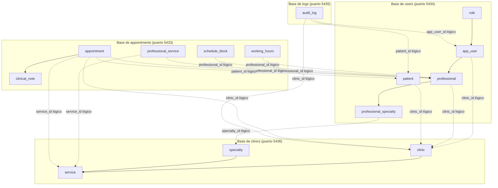
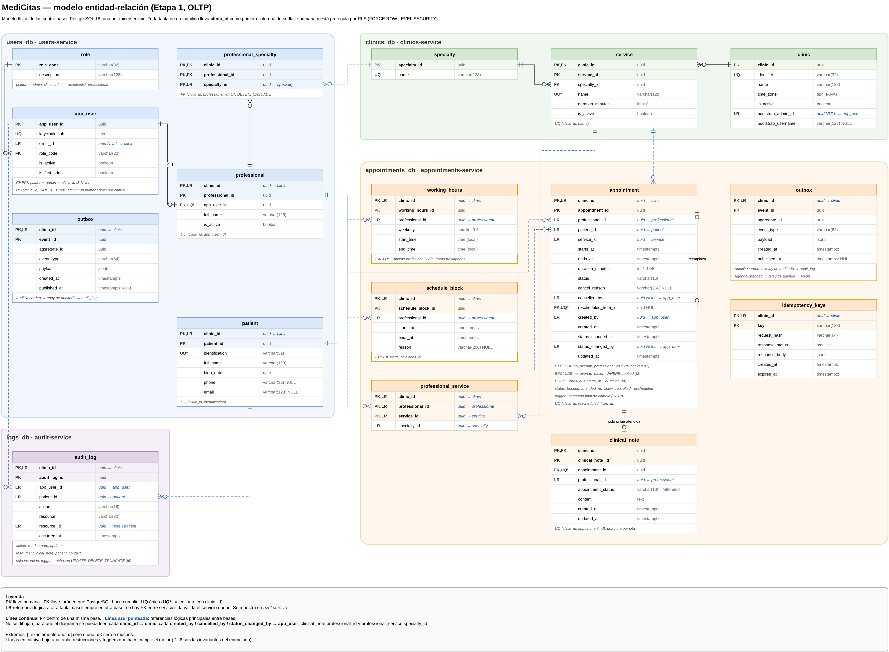

# Arquitectura de bases de datos (microservicios)

[English](database.md) · **Español**

MediCitas guarda sus datos en cuatro bases PostgreSQL 18, una por servicio de dominio.

Vea el [diccionario de datos](data-dictionary.es.md) para columnas, claves y
diferencias entre bases nuevas y existentes.

---

## 1. Distribución de dominios y tablas



### Diagrama entidad-relación

[](er-diagram.es.drawio.png)

El modelo físico completo: cada tabla de las cuatro bases con sus columnas, tipos,
llaves y las restricciones que hace cumplir el motor. La fuente es
[`er-diagram.drawio`](er-diagram.drawio); se abre en [draw.io](https://app.diagrams.net)
(tiene una página en inglés y otra en español) y, después de un cambio, se exporta
otra vez cada página como PNG.

- **Las líneas continuas** son llaves foráneas dentro de una misma base.
- **Las líneas azules punteadas** son referencias lógicas entre bases: no hay llaves
  foráneas entre servicios, así que el servicio que escribe la fila valida que el id
  exista (ver la [sección 3](#3-integridad-referencial-entre-microservicios)).
- La mayoría de las tablas por clínica usa llaves compuestas que empiezan con
  `clinic_id`. Hay excepciones: `clinic` y `app_user`, cuya clínica es nula para
  usuarios de plataforma. Los catálogos globales `role` y `specialty` tienen llaves
  propias. Las referencias a `clinic` se omiten para facilitar la lectura.

---

## 2. Detalle de cada base

### 1. Base de clinics (`clinics_db`)
- **Contenedor:** `postgre_clinics_MediCitas`
- **Puerto externo por defecto:** `5436` (interno `5432`)
- **Script de inicio:** `database/clinics/init.sql`
- **Responsabilidad:** sedes o clínicas, catálogo de especialidades médicas y catálogo de servicios de salud que ofrece cada clínica.
- **Tablas:**
  - `clinic`: datos de la sede o clínica (identificador, nombre, zona horaria, estado activo).
  - `specialty`: catálogo global de especialidades médicas (Cardiología, Pediatría, etc.).
  - `service`: catálogo de servicios de salud por clínica, con su duración en minutos y su especialidad.

### 2. Base de users (`users_db`)
- **Contenedor:** `postgre_users_MediCitas`
- **Puerto externo por defecto:** `5434` (interno `5432`)
- **Script de inicio:** `database/users/init.sql`
- **Responsabilidad:** asociación de identidades, roles de dominio, perfiles de profesionales de salud y registro de pacientes.
- **Tablas:**
  - `role`: roles del sistema (`platform_admin`, `clinic_admin`, `receptionist`, `professional`).
  - `app_user`: enlace entre la identidad de Keycloak (`keycloak_sub`) y el rol y la clínica del dominio.
  - `professional`: perfil del profesional de salud (médicos, terapeutas), enlazado 1:1 con un usuario de la aplicación.
  - `professional_specialty`: relación muchos a muchos (N:M) entre profesionales y especialidades.
  - `patient`: registro de pacientes por clínica (identificación, nombre completo, fecha de nacimiento, datos de contacto).
  - `outbox`: eventos `AuditRecorded` de escrituras de contacto; la aplicación inserta y el relay de auditoría lee y marca como publicados.

### 3. Base de appointments (`appointments_db`)
- **Contenedor:** `postgre_appointments_MediCitas`
- **Puerto externo por defecto:** `5433` (interno `5432`)
- **Script de inicio:** `database/appointments/init.sql`
- **Responsabilidad:** agendamiento de citas, gestión de la disponibilidad (horarios semanales y bloqueos o permisos) y notas clínicas.
- **Tablas:**
  - `working_hours`: horarios semanales recurrentes por profesional (la extensión `btree_gist` impide solapes internos).
  - `schedule_block`: intervalos de vacaciones o permisos por profesional.
  - `professional_service`: qué servicios puede atender cada profesional.
  - `appointment`: citas médicas reservadas. Tiene restricciones `EXCLUDE USING gist` que impiden reservas dobles concurrentes, tanto por profesional como por paciente, y triggers para las transiciones de estado.
  - `clinical_note`: registros de consulta médica altamente sensibles (1:1 con citas atendidas).
  - `outbox`: outbox transaccional para eventos de dominio (`AgendaChanged`, `AuditRecorded`) con un índice parcial sobre las filas pendientes (`published_at IS NULL`). Los roles de la aplicación solo pueden hacer `INSERT` en su clínica; `medicitas_relay` tiene `SELECT` y `UPDATE` sobre todas las clínicas.
  - `idempotency_keys`: esquema reservado para respuestas de idempotencia por clínica. La API no lo lee ni escribe; `Idempotency-Key` no está implementado.

### 4. Base de logs (`logs_db`)
- **Contenedor:** `postgre_logs_MediCitas`
- **Puerto externo por defecto:** `5435` (interno `5432`)
- **Script de inicio:** `database/logs/init.sql`
- **Responsabilidad:** trazabilidad y auditoría de los accesos y cambios a registros sensibles (notas clínicas y datos de contacto de pacientes).
- **Tablas:**
  - `audit_log`: bitácora inmutable de solo inserción (protegida a nivel del motor contra `UPDATE`, `DELETE` y `TRUNCATE`).

---

## 3. Integridad referencial entre microservicios

En una arquitectura de microservicios con bases aisladas:
1. **Sin llaves foráneas entre bases:** las restricciones de llave foránea entre bases de distintos servicios se reemplazan por referencias lógicas (`UUID`). Los identificadores generados usan **UUID v7** (RFC 9562) mediante `uuidv7()` nativo para mantener localidad temporal en índices B-tree.
2. **Índices sobre las referencias lógicas:** las columnas que referencian a otro servicio (por ejemplo `clinic_id`, `professional_id`, `patient_id`) están cubiertas por índices B-tree compuestos que empiezan con `clinic_id`, uno por cada consulta a la que sirven. Cada uno se justifica con su plan de ejecución en [indexes.es.md](indexes.es.md).
3. **Llaves compuestas por clínica:** la mayoría de las tablas por tenant incluye `clinic_id` en sus llaves y referencias locales. Esto facilita una distribución futura por clínica; no hay particionamiento ni sharding configurados.
4. **Validación de integridad:** los adaptadores HTTP verifican catálogo, pertenencia del paciente y asociaciones del profesional. Estas llamadas y las bases dueñas no comparten transacción: un cambio posterior en otro servicio puede invalidar una comprobación previa. Los relays entregan eventos; no equivalen a llaves foráneas entre bases.

---

## 4. Row-Level Security (RLS) y multi-tenancy

Para imponer un aislamiento estricto entre clínicas (**invariante I5**) y un control de acceso por rol con el menor privilegio (**RF15**, **RF17**, **RF18**, **RF19**), MediCitas implementa **Row-Level Security (RLS)** de forma nativa en PostgreSQL 18.

### Estrategia de multi-tenancy

Las bases de servicio comparten tablas por tenant con discriminador `clinic_id` y RLS.
La [comparación de estrategias](database-comparison.es.md) explica las alternativas y costos.

---

### Protocolo de contexto de sesión (GUCs)

La capa de aplicación o el middleware de autenticación inyecta los claims verificados del token JWT en parámetros de configuración locales a la transacción de PostgreSQL:

```sql
-- Se ejecuta dentro de un bloque de transacción (SET LOCAL o con la función auxiliar):
SELECT app_set_session_context(
    p_clinic_id        := 'clinic-uuid',
    p_user_id          := 'user-uuid',
    p_role             := 'receptionist',         -- platform_admin | clinic_admin | receptionist | professional
    p_professional_id  := NULL,                   -- uuid del profesional (solo si role = professional)
    p_is_local         := true                    -- aplica solo a la transacción actual
);
```

#### Funciones auxiliares disponibles en todas las bases:
- `app_current_clinic_id()`: devuelve el UUID de la clínica activa (o `NULL` para `platform_admin`).
- `app_current_user_id()`: devuelve el UUID del usuario autenticado de la aplicación.
- `app_current_role()`: devuelve el código del rol de dominio activo (`platform_admin`, `clinic_admin`, `receptionist`, `professional`).
- `app_current_professional_id()`: devuelve el UUID del profesional de salud, si aplica.
- `app_is_platform_admin()`: devuelve `true` si el rol actual es `platform_admin`.

Sin contexto, las funciones de identidad devuelven `NULL` y `app_is_platform_admin()`
devuelve `false`. Las políticas de igualdad por clínica ocultan filas. Los catálogos
globales permiten lecturas sin contexto de clínica; no es una regla para toda tabla.

---

### Matriz de políticas RLS por entidad y rol

Las tablas de dominio habilitan y fuerzan RLS. `FORCE` incluye a los dueños ordinarios,
pero superusuarios y roles con `BYPASSRLS` lo omiten. La matriz describe políticas y
permisos SQL para `medicitas_app`, no endpoints HTTP; vea el [contrato de API](api.es.md).

| Base | Tabla | platform_admin | clinic_admin | receptionist | professional |
| :--- | :--- | :--- | :--- | :--- | :--- |
| **Clinics DB** | `clinic` | CRUD completo | Lee/actualiza su clínica | Lee su clínica | Lee su clínica |
| | `specialty` | CRUD completo | Solo lectura | Solo lectura | Solo lectura |
| | `service` | Lee/inserta/actualiza | Lee/inserta/actualiza en su clínica | Solo lectura de su clínica | Solo lectura de su clínica |
| **Users DB** | `role` | Solo lectura | Solo lectura | Solo lectura | Solo lectura |
| | `app_user` | Lee/inserta/actualiza; bootstrap de primer administrador | Lee/inserta/actualiza en su clínica (sin administradores de plataforma) | Lee la clínica | Lee la clínica |
| | `professional`| Lectura/inserción/actualización global | Lee/inserta/actualiza en su clínica | Solo lectura de su clínica | Lee la clínica / actualiza su propio perfil |
| | `patient` | **Sin acceso** | Lee/inserta/actualiza en su clínica | Lee/inserta/actualiza en su clínica | Solo lectura de su clínica |
| **Appointments DB** | `working_hours` | **Sin acceso** | CRUD de su clínica | Solo lectura de su clínica | CRUD de su propio horario |
| | `schedule_block`| **Sin acceso** | CRUD de su clínica | Solo lectura de su clínica | CRUD de sus propios permisos y bloqueos |
| | `appointment` | **Sin acceso** | Lee/inserta/actualiza en su clínica | Lee/inserta/actualiza en su clínica | Lee la clínica / actualiza sus propias citas |
| | `clinical_note` | **Sin acceso** | **Sin acceso** | **Sin acceso** | Lee/inserta/actualiza sus notas; la API exige cita atendida al crear |
| **Logs DB** | `audit_log` | Solo inserción | Lee/inserta en su clínica | Inserta en su clínica | Inserta en su clínica |

Las políticas INSERT de auditoría sirven a productores/relay; HTTP solo expone la
consulta del administrador de clínica. SQL impide borrar usuarios, profesionales,
pacientes, citas y notas. `app_user` permite además leerse por `app_user_id`; los
handlers agregan filtros de clínica para gestionar usuarios. RLS no reemplaza las
validaciones de campos y reglas de negocio.

---

### Rol de base con menor privilegio (`medicitas_app`)

Cada base define un rol de aplicación `medicitas_app`:
- No es superusuario ni dueño del esquema.
- SQL también define `db_admin`, `db_receptionist` y `db_professional`. Los handlers actuales eligen `medicitas_app` para todos los actores; RLS usa el rol de dominio del contexto transaccional.
- Compose conecta con el `POSTGRES_USER` de cada base y los handlers cambian de rol. Este login de desarrollo es privilegiado; la protección depende de usar el rol restringido. Los relays usan `medicitas_relay` para el outbox.
- En `logs_db` solo tiene permisos de `SELECT` e `INSERT` (estrictamente de solo inserción: `UPDATE` y `DELETE` se niegan en los permisos del motor).

---

## 5. Despliegue con Docker Compose

Después de preparar el `.env` local como indica el [README](../README.es.md#arranque-local),
este comando levanta solo las cuatro bases. No arranca los servicios HTTP, Keycloak ni Redis:

```bash
# Levantar solo las cuatro bases
docker compose up -d db_clinics db_users db_appointments db_logs

# Verificar el estado de salud de los contenedores
docker compose ps
```
