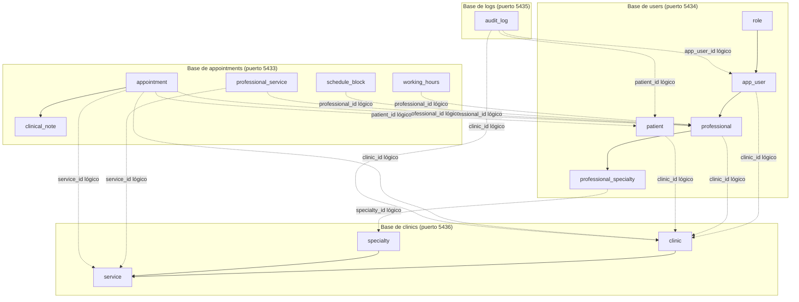

# Arquitectura de bases de datos (microservicios)

[English](database.md) · **Español**

En MediCitas, la persistencia está repartida en 4 bases relacionales independientes (PostgreSQL 17), diseñadas para una arquitectura de microservicios que aplica el patrón **una base por servicio** (*Database-per-Service*).

---

## 1. Distribución de dominios y tablas



---

## 2. Detalle de cada base

### 1. Base de clinics (`clinics_db`)
- **Contenedor:** `postgre_clinics_MediCitas`
- **Puerto externo por defecto:** `5436` (interno `5432`)
- **Script de inicio:** `database/clinics/init.sql`
- **Responsabilidad:** sedes o clínicas, catálogo de especialidades médicas y catálogo de servicios de salud que ofrece cada clínica.
- **Tablas:**
  - `clinic`: datos de la sede o clínica (identificador, nombre, zona horaria, estado activo).
  - `specialty`: catálogo global de especialidades médicas (Cardiología, Pediatría, etc.).
  - `service`: catálogo de servicios de salud por clínica, con su duración en minutos y su especialidad.

### 2. Base de users (`users_db`)
- **Contenedor:** `postgre_users_MediCitas`
- **Puerto externo por defecto:** `5434` (interno `5432`)
- **Script de inicio:** `database/users/init.sql`
- **Responsabilidad:** asociación de identidades, roles de dominio, perfiles de profesionales de salud y registro de pacientes.
- **Tablas:**
  - `role`: roles del sistema (`platform_admin`, `clinic_admin`, `receptionist`, `professional`).
  - `app_user`: enlace entre la identidad de Keycloak (`keycloak_sub`) y el rol y la clínica del dominio.
  - `professional`: perfil del profesional de salud (médicos, terapeutas), enlazado 1:1 con un usuario de la aplicación.
  - `professional_specialty`: relación muchos a muchos (N:M) entre profesionales y especialidades.
  - `patient`: registro de pacientes por clínica (identificación, nombre completo, fecha de nacimiento, datos de contacto).

### 3. Base de appointments (`appointments_db`)
- **Contenedor:** `postgre_appointments_MediCitas`
- **Puerto externo por defecto:** `5433` (interno `5432`)
- **Script de inicio:** `database/appointments/init.sql`
- **Responsabilidad:** agendamiento de citas, gestión de la disponibilidad (horarios semanales y bloqueos o permisos) y notas clínicas.
- **Tablas:**
  - `working_hours`: horarios semanales recurrentes por profesional (la extensión `btree_gist` impide solapes internos).
  - `schedule_block`: intervalos de vacaciones o permisos por profesional.
  - `professional_service`: qué servicios puede atender cada profesional.
  - `appointment`: citas médicas reservadas. Tiene restricciones `EXCLUDE USING gist` que impiden reservas dobles concurrentes, tanto por profesional como por paciente, y triggers para las transiciones de estado.
  - `clinical_note`: registros de consulta médica altamente sensibles (1:1 con citas atendidas).
  - `outbox`: outbox transaccional para eventos de dominio (`AgendaChanged`, `AppointmentBooked`, etc.) con un índice parcial sobre las filas pendientes (`published_at IS NULL`). Los roles de la aplicación solo pueden hacer `INSERT` en su clínica; `medicitas_relay` tiene `SELECT` y `UPDATE` sobre todas las clínicas.
  - `idempotency_keys`: guarda por clínica las respuestas asociadas a un `Idempotency-Key` en las peticiones de reserva (E5).

### 4. Base de logs (`logs_db`)
- **Contenedor:** `postgre_logs_MediCitas`
- **Puerto externo por defecto:** `5435` (interno `5432`)
- **Script de inicio:** `database/logs/init.sql`
- **Responsabilidad:** trazabilidad y auditoría de los accesos y cambios a registros sensibles (notas clínicas y datos de contacto de pacientes).
- **Tablas:**
  - `audit_log`: bitácora inmutable de solo inserción (protegida a nivel del motor contra `UPDATE`, `DELETE` y `TRUNCATE`).

---

## 3. Integridad referencial entre microservicios

En una arquitectura de microservicios con bases aisladas:
1. **Sin llaves foráneas entre bases:** las restricciones de llave foránea entre bases de distintos servicios se reemplazan por referencias lógicas (`UUID`). Los identificadores generados usan **UUID v7** (RFC 9562) mediante `gen_uuid_v7()` para mantener localidad temporal en índices B-tree.
2. **Índices sobre las llaves lógicas:** cada columna que referencia a otro servicio (por ejemplo `clinic_id`, `professional_id`, `patient_id`) tiene su propio índice B-tree para optimizar los planes de ejecución y el filtrado por tenant.
3. **Llaves compuestas listas para sharding:** las tablas por clínica incluyen `clinic_id` en sus llaves primarias, llaves foráneas intra-base, restricciones únicas y restricciones `EXCLUDE USING gist` para permitir particionamiento o sharding horizontal por `clinic_id`.
4. **Validación de la integridad:** la consistencia de negocio entre servicios se impone en la capa de aplicación, mediante verificaciones transaccionales o mensajería asíncrona.

---

## 4. Row-Level Security (RLS) y multi-tenancy

Para imponer un aislamiento estricto entre clínicas (**invariante I5**) y un control de acceso por rol con el menor privilegio (**RF15**, **RF17**, **RF18**, **RF19**), MediCitas implementa **Row-Level Security (RLS)** de forma nativa en PostgreSQL 17.

### Comparación de estrategias de multi-tenancy

| Estrategia | Ventajas | Desventajas | Decisión en MediCitas |
| :--- | :--- | :--- | :--- |
| **Esquema por tenant (`CREATE SCHEMA`)** | Aislamiento físico de tablas por esquema; separación lógica limpia. | Multiplica las migraciones DDL por clínica; complica el enrutamiento de conexiones; mantener los esquemas a escala es caro. | Descartada por la carga operativa y la complejidad de escalar con muchas sedes. |
| **Columna discriminadora (`clinic_id`) en la aplicación** | Modelo relacional simple; consultas directas. | Si una consulta o el ORM olvida `WHERE clinic_id = ...`, los datos se filtran en silencio (defecto de seguridad en la capa de aplicación). | Se adopta como base relacional, pero no alcanza por sí sola sin una imposición a nivel del motor. |
| **Row-Level Security (RLS) + columna discriminadora** | **Aislamiento impuesto por el motor:** PostgreSQL intercepta y filtra cada `SELECT`, `INSERT`, `UPDATE` y `DELETE`; impide por completo las fugas aunque se manipulen parámetros o se omitan filtros en la aplicación. | Requiere inicializar variables de contexto de sesión (`SET LOCAL`) en cada transacción. | **Elegida como estándar central de multi-tenancy de MediCitas.** |

---

### Protocolo de contexto de sesión (GUCs)

La capa de aplicación o el middleware de autenticación inyecta los claims verificados del token JWT en parámetros de configuración locales a la transacción de PostgreSQL:

```sql
-- Se ejecuta dentro de un bloque de transacción (SET LOCAL o con la función auxiliar):
SELECT app_set_session_context(
    p_clinic_id        := 'clinic-uuid',
    p_user_id          := 'user-uuid',
    p_role             := 'receptionist',         -- platform_admin | clinic_admin | receptionist | professional
    p_professional_id  := NULL,                   -- uuid del profesional (solo si role = professional)
    p_is_local         := true                    -- aplica solo a la transacción actual
);
```

#### Funciones auxiliares disponibles en todas las bases:
- `app_current_clinic_id()`: devuelve el UUID de la clínica activa (o `NULL` para `platform_admin`).
- `app_current_user_id()`: devuelve el UUID del usuario autenticado de la aplicación.
- `app_current_role()`: devuelve el código del rol de dominio activo (`platform_admin`, `clinic_admin`, `receptionist`, `professional`).
- `app_current_professional_id()`: devuelve el UUID del profesional de salud, si aplica.
- `app_is_platform_admin()`: devuelve `true` si el rol actual es `platform_admin`.

> [!IMPORTANT]
> **Denegar por defecto:** cuando una consulta corre sin un contexto de sesión inicializado, estas funciones devuelven `NULL` de forma segura. En consecuencia, los predicados de RLS evalúan a `FALSE`, se devuelven cero filas y se impide el acceso no autorizado.

---

### Matriz de políticas RLS por entidad y rol

Cada tabla tiene activados `ENABLE ROW LEVEL SECURITY` y `FORCE ROW LEVEL SECURITY` (lo que obliga a aplicar las políticas incluso al usuario dueño de la base):

| Base | Tabla | platform_admin | clinic_admin | receptionist | professional |
| :--- | :--- | :--- | :--- | :--- | :--- |
| **Clinics DB** | `clinic` | CRUD completo | Lee su clínica | Lee su clínica | Lee su clínica |
| | `specialty` | CRUD completo | Solo lectura | Solo lectura | Solo lectura |
| | `service` | CRUD completo | CRUD de su clínica | Solo lectura de su clínica | Solo lectura de su clínica |
| **Users DB** | `role` | Solo lectura | Solo lectura | Solo lectura | Solo lectura |
| | `app_user` | CRUD completo | CRUD de su clínica (sin administradores de plataforma) | Solo lectura de su clínica | Lee su propio perfil |
| | `professional`| Lectura global | CRUD de su clínica | Solo lectura de su clínica | Lee la clínica / actualiza su propio perfil |
| | `patient` | **Sin acceso** | CRUD de su clínica | CRUD de su clínica | Solo lectura de su clínica |
| **Appointments DB** | `working_hours` | **Sin acceso** | CRUD de su clínica | Solo lectura de su clínica | CRUD de su propio horario |
| | `schedule_block`| **Sin acceso** | CRUD de su clínica | Solo lectura de su clínica | CRUD de sus propios permisos y bloqueos |
| | `appointment` | **Sin acceso** | CRUD de su clínica | CRUD de su clínica | Lee la clínica / actualiza el desenlace de sus propias citas |
| | `clinical_note` | **Sin acceso** | **Sin acceso** | **Sin acceso** | **Solo de sus propias citas atendidas (RF15)** |
| **Logs DB** | `audit_log` | **Sin acceso** | **Lee su clínica (RF19)** | **Sin acceso** | **Sin acceso** |

---

### Rol de base con menor privilegio (`medicitas_app`)

Cada base define un rol de aplicación `medicitas_app`:
- No es superusuario ni dueño del esquema.
- En `logs_db` solo tiene permisos de `SELECT` e `INSERT` (estrictamente de solo inserción: `UPDATE` y `DELETE` se niegan en los permisos del motor).

---

## 5. Despliegue con Docker Compose

Para levantar todas las bases y servicios:

```bash
# Levantar todas las bases y servicios requeridos
docker compose --env-file .env.example up -d db_clinics db_users db_appointments db_logs

# Verificar el estado de salud de los contenedores
docker compose ps
```
