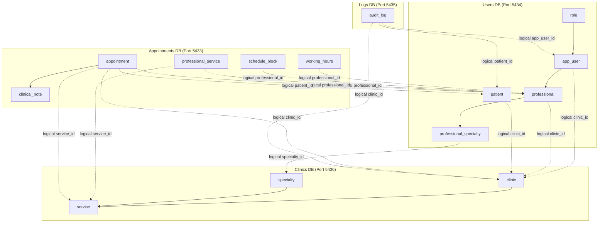
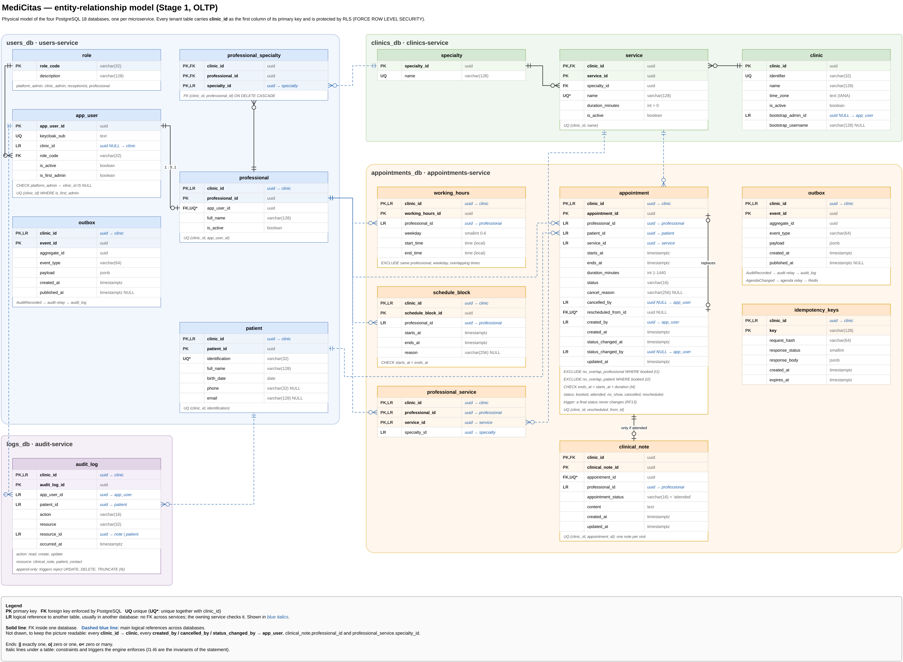

# Database Architecture (Microservices)

**English** · [Español](database.es.md)

MediCitas stores its data in four PostgreSQL 18 databases, one per domain service.

See the [data dictionary](data-dictionary.md) for columns, keys and differences
between new and existing databases.

---

## 1. Domain and Table Distribution



### Entity-relationship diagram

[](er-diagram.drawio.png)

The full physical model: every table of the four databases with its columns, types,
keys and the constraints the engine enforces. The source is
[`er-diagram.drawio`](er-diagram.drawio); open it in [draw.io](https://app.diagrams.net)
(it has an English and a Spanish page) and export each page again as PNG after a change.

- **Solid lines** are foreign keys inside one database.
- **Dashed blue lines** are logical references across databases: there is no foreign
  key between services, so the service that writes the row checks that the id exists
  (see [section 3](#3-referential-integrity-in-microservices)).
- Most tenant tables use composite keys starting with `clinic_id`. Exceptions include
  `clinic` itself and `app_user`, whose clinic is nullable for platform users.
  Global catalogs `role` and `specialty` have their own keys. Clinic references
  are omitted from the picture for readability.

---

## 2. Database Breakdown

### 1. Clinics Database (`clinics_db`)
- **Container:** `postgre_clinics_MediCitas`
- **Default External Port:** `5436` (internal `5432`)
- **Init Script:** `database/clinics/init.sql`
- **Responsibility:** Clinic branches, medical specialties catalog, and healthcare services catalog offered by each clinic.
- **Tables:**
  - `clinic`: Branch or clinic metadata (identifier, name, time zone, active status).
  - `specialty`: Global catalog of medical specialties (Cardiology, Pediatrics, etc.).
  - `service`: Healthcare service catalog per clinic with duration in minutes, associated with a specialty.

### 2. Users Database (`users_db`)
- **Container:** `postgre_users_MediCitas`
- **Default External Port:** `5434` (internal `5432`)
- **Init Script:** `database/users/init.sql`
- **Responsibility:** Identity mapping, domain roles, healthcare professional profiles, and patient registry.
- **Tables:**
  - `role`: System roles (`platform_admin`, `clinic_admin`, `receptionist`, `professional`).
  - `app_user`: Link between Keycloak identity (`keycloak_sub`) and the domain role/clinic.
  - `professional`: Healthcare professional profile (physicians, therapists) linked 1:1 with an application user.
  - `professional_specialty`: Many-to-many (N:M) relationship between professionals and specialties.
  - `patient`: Patient registry per clinic (identification, full name, birth date, contact details).
  - `outbox`: `AuditRecorded` events for patient contact writes; the application can insert and the audit relay can read and mark them published.

### 3. Appointments Database (`appointments_db`)
- **Container:** `postgre_appointments_MediCitas`
- **Default External Port:** `5433` (internal `5432`)
- **Init Script:** `database/appointments/init.sql`
- **Responsibility:** Appointment scheduling, availability management (weekly working hours and schedule leaves/blocks), and clinical notes.
- **Tables:**
  - `working_hours`: Weekly recurring schedules per professional (prevents internal overlapping via the `btree_gist` extension).
  - `schedule_block`: Vacation or leave intervals per professional.
  - `professional_service`: Mapping of which services each professional is eligible to perform.
  - `appointment`: Booked medical appointments. Features `EXCLUDE USING gist` constraints to prevent concurrent double-booking for both professionals and patients, as well as status transition triggers.
  - `clinical_note`: Highly sensitive medical consultation records (1:1 with attended appointments).
  - `outbox`: Transactional outbox for domain events (`AgendaChanged`, `AuditRecorded`) with a partial index on pending rows (`published_at IS NULL`). App roles can only `INSERT` per clinic; `medicitas_relay` has `SELECT` and `UPDATE` across all clinics.
  - `idempotency_keys`: Schema reserved for per-clinic idempotency responses. The API does not read or write it; `Idempotency-Key` is not implemented.

### 4. Logs Database (`logs_db`)
- **Container:** `postgre_logs_MediCitas`
- **Default External Port:** `5435` (internal `5432`)
- **Init Script:** `database/logs/init.sql`
- **Responsibility:** Traceability and auditing of access and changes to sensitive records (clinical notes and patient contact information).
- **Tables:**
  - `audit_log`: Immutable append-only audit trail (protected at the database engine level against `UPDATE`, `DELETE`, and `TRUNCATE`).

---

## 3. Referential Integrity in Microservices

In a microservices architecture with isolated databases:
1. **No Cross-Database Foreign Keys:** Foreign key constraints across different service databases are replaced with logical references (`UUID`). Entity identifiers default to RFC 9562 **UUID v7** via native `uuidv7()` for time-ordered B-tree locality.
2. **Indexes on logical references:** Cross-reference columns (e.g., `clinic_id`, `professional_id`, `patient_id`) are covered by composite B-tree indexes that start with `clinic_id`, one per query they serve. Each one is justified by its execution plan in [indexes.md](indexes.md).
3. **Composite tenant keys:** Most tenant tables include `clinic_id` in their keys and local references. This supports a future distribution by clinic; partitioning and sharding are not configured.
4. **Integrity validation:** HTTP adapters validate the catalog, patient membership and professional assignments. These calls and the owning databases do not share a transaction: a later change in another service can invalidate an earlier check. Outbox relays deliver events; they do not provide cross-database foreign keys.

---

## 4. Row-Level Security (RLS) & Multi-Tenancy

To enforce strict clinic isolation (**Invariant I5**) and least-privilege role-based access control (**RF15**, **RF17**, **RF18**, **RF19**), MediCitas implements **Row-Level Security (RLS)** natively within PostgreSQL 18.

### Multi-tenancy strategy

The service databases share tenant tables with a `clinic_id` discriminator and RLS.
The [strategy comparison](database-comparison.md) explains the alternatives and costs.

---

### Session Context Protocol (GUCs)

The application layer or authentication middleware injects the verified identity claims from the JWT token into PostgreSQL transaction-local configuration parameters:

```sql
-- Executed inside a transaction block (SET LOCAL or via the helper function):
SELECT app_set_session_context(
    p_clinic_id        := 'clinic-uuid',
    p_user_id          := 'user-uuid',
    p_role             := 'receptionist',         -- platform_admin | clinic_admin | receptionist | professional
    p_professional_id  := NULL,                   -- professional uuid (only when role = professional)
    p_is_local         := true                    -- applies only to the current transaction
);
```

#### Helper Functions Available in All Databases:
- `app_current_clinic_id()`: Returns the UUID of the active clinic (or `NULL` for `platform_admin`).
- `app_current_user_id()`: Returns the UUID of the authenticated application user.
- `app_current_role()`: Returns the active domain role code (`platform_admin`, `clinic_admin`, `receptionist`, `professional`).
- `app_current_professional_id()`: Returns the healthcare professional UUID if applicable.
- `app_is_platform_admin()`: Returns `true` if the current role is `platform_admin`.

Without context, identity helpers return `NULL` and `app_is_platform_admin()` returns
`false`. Tenant equality policies hide rows. Global catalogs intentionally allow
reads without clinic context, so this is not a blanket rule for every table.

---

### RLS Policy Matrix by Entity and Role

Domain tables enable and force RLS. `FORCE` includes ordinary owners, but superusers
and roles with `BYPASSRLS` bypass it. The matrix describes SQL policies/grants for
`medicitas_app`, not HTTP endpoints; see the [API contract](api.md) for exposed actions.

| Database | Table | platform_admin | clinic_admin | receptionist | professional |
| :--- | :--- | :--- | :--- | :--- | :--- |
| **Clinics DB** | `clinic` | Full CRUD | Read/update own clinic | Read own clinic | Read own clinic |
| | `specialty` | Full CRUD | Read-only | Read-only | Read-only |
| | `service` | Read/insert/update | Read/insert/update own clinic | Read-only for own clinic | Read-only for own clinic |
| **Users DB** | `role` | Read-only | Read-only | Read-only | Read-only |
| | `app_user` | Read/insert/update; first-admin bootstrap | Read/insert/update own clinic (non-platform admins) | Read clinic | Read clinic |
| | `professional`| Global read/insert/update | Read/insert/update own clinic | Read-only for own clinic | Read clinic / Update own profile |
| | `patient` | **No access** | Read/insert/update own clinic | Read/insert/update own clinic | Read-only for own clinic |
| **Appointments DB** | `working_hours` | **No access** | CRUD for own clinic | Read-only for own clinic | CRUD for own schedule |
| | `schedule_block`| **No access** | CRUD for own clinic | Read-only for own clinic | CRUD for own leaves/blocks |
| | `appointment` | **No access** | Read/insert/update own clinic | Read/insert/update own clinic | Read clinic / Update own appointments |
| | `clinical_note` | **No access** | **No access** | **No access** | Read/insert/update own notes; API requires an attended appointment to create |
| **Logs DB** | `audit_log` | Insert only | Read/insert own clinic | Insert own clinic | Insert own clinic |

Audit INSERT policies support producers/relay; HTTP exposes only the clinic-admin
query. SQL denies deletion of users, professionals, patients, appointments and notes.
`app_user` also has a self-read exception by `app_user_id`; domain handlers add clinic
predicates for managed targets. RLS does not replace field-level business validation.

---

### Least Privilege Database Role (`medicitas_app`)

Each database defines an application role `medicitas_app`:
- It is neither a superuser nor an owner of the schema.
- SQL also defines `db_admin`, `db_receptionist` and `db_professional`. Current domain handlers select `medicitas_app` for all actors; RLS uses the domain role in the transaction context.
- Compose connects with each database's `POSTGRES_USER`, then handlers switch role. This development login is privileged; protection depends on using the restricted role. Relays use `medicitas_relay` for the outbox.
- In `logs_db`, it only has `SELECT` and `INSERT` permissions (strictly append-only, denying `UPDATE` and `DELETE` at the engine permission level).

---

## 5. Deployment with Docker Compose

After preparing the local `.env` as in the [README](../README.md#local-startup),
this command starts only the four databases. It does not start the HTTP services,
Keycloak or Redis:

```bash
# Start only the four databases
docker compose up -d db_clinics db_users db_appointments db_logs

# Verify container health status
docker compose ps
```
