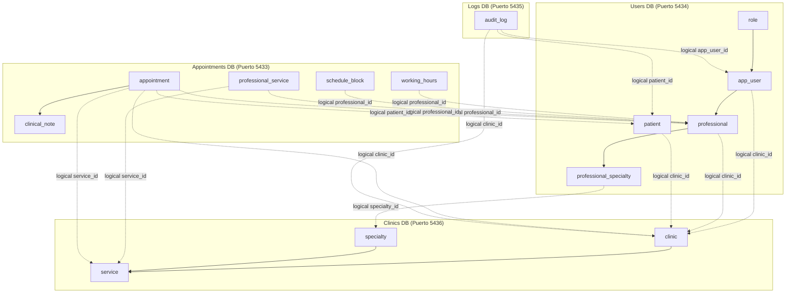

# Arquitectura de Bases de Datos (Microservicios)

En MediCitas la persistencia se divide en 4 bases de datos relacionales independientes (PostgreSQL 17), preparadas para la transición a una arquitectura de microservicios con el patrón **Database-per-Service**.

---

## 1. Distribución de Dominios y Tablas



---

## 2. Detalle por Base de Datos

### 1. Clinics Database (`clinics_db`)
- **Contenedor:** `postgre_clinics_MediCitas`
- **Puerto externo por defecto:** `5436` (interno `5432`)
- **Directorio Init:** `database/clinics/init.sql`
- **Responsabilidad:** Catálogo de clínicas, especialidades médicas y catálogo de servicios de salud ofrecidos por cada clínica.
- **Tablas:**
  - `clinic`: Información de la sede o clínica (identificador, nombre, zona horaria, estado).
  - `specialty`: Catálogo global de especialidades médicas (Cardiología, Pediatría, etc.).
  - `service`: Catálogo de servicios por clínica con duración en minutos, vinculado a una especialidad.

### 2. Users Database (`users_db`)
- **Contenedor:** `postgre_users_MediCitas`
- **Puerto externo por defecto:** `5434` (interno `5432`)
- **Directorio Init:** `database/users/init.sql`
- **Responsabilidad:** Gestión de identidades, roles de dominio, perfiles de profesionales de la salud y padrón de pacientes.
- **Tablas:**
  - `role`: Roles del sistema (`platform_admin`, `clinic_admin`, `receptionist`, `professional`).
  - `app_user`: Vínculo entre la identidad en Keycloak (`keycloak_sub`) y el rol/clínica del dominio.
  - `professional`: Perfil de profesionales de la salud (médicos, terapeutas) vinculado 1:1 con un usuario.
  - `professional_specialty`: Relación N:M de especialidades por profesional.
  - `patient`: Registro de pacientes de cada clínica (identificación, nombre, fecha de nacimiento, contacto).

### 3. Appointments Database (`appointments_db`)
- **Contenedor:** `postgre_appointments_MediCitas`
- **Puerto externo por defecto:** `5433` (interno `5432`)
- **Directorio Init:** `database/appointments/init.sql`
- **Responsabilidad:** Agendamiento de citas, control de disponibilidad (horarios semanales y bloqueos por vacaciones), y notas clínicas.
- **Tablas:**
  - `working_hours`: Horarios semanales por profesional (restringe solapamientos con extensión `btree_gist`).
  - `schedule_block`: Períodos de bloqueo / vacaciones por profesional.
  - `professional_service`: Mapeo de qué servicios brinda cada profesional.
  - `appointment`: Citas médicas programadas. Cuenta con exclusión `EXCLUDE USING gist` para evitar doble agendamiento concurrente tanto para el profesional como para el paciente, y trigger de transición de estados.
  - `clinical_note`: Registro clínico sensible de la atención médica (1:1 con citas atendidas).

### 4. Logs Database (`logs_db`)
- **Contenedor:** `postgre_logs_MediCitas`
- **Puerto externo por defecto:** `5435` (interno `5432`)
- **Directorio Init:** `database/logs/init.sql`
- **Responsabilidad:** Trazabilidad y auditoría de accesos y modificaciones a datos sensibles (notas clínicas y contactos de pacientes).
- **Tablas:**
  - `audit_log`: Registro inmutable tipo append-only (protegido a nivel de base de datos contra `UPDATE`, `DELETE` y `TRUNCATE`).

---

## 3. Integridad Referencial y Microservicios

En una arquitectura de microservicios con bases de datos aisladas:
1. **Sin Foreign Keys Cruzadas:** Las restricciones `FOREIGN KEY` entre tablas de diferentes bases de datos se reemplazan por referencias lógicas (`UUID`).
2. **Índices de Llaves Foráneas Lógicas:** Cada columna de referencia cruzada (por ejemplo `clinic_id`, `professional_id`, `patient_id`) cuenta con un índice B-tree para optimizar las consultas y filtros.
3. **Validación de Integridad:** La consistencia de negocio entre servicios se valida en la capa de aplicación o mediante mensajería/eventos asíncronos.

---

## 4. Despliegue con Docker Compose

Para levantar las bases de datos:

```bash
# Levantar todas las bases de datos y servicios
docker compose --env-file .env.example up -d db_clinics db_users db_appointments db_logs

# Verificar estado de salud de los contenedores
docker compose ps
```
