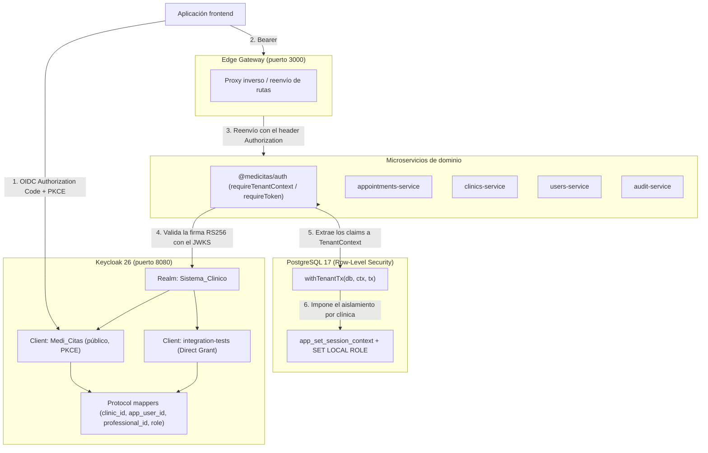

# Arquitectura de identidad multi-tenant con Keycloak

[English](keycloak.md) · **Español**

MediCitas usa **Keycloak 26** como proveedor centralizado de identidad y acceso (IAM), con una arquitectura de **un solo realm y mappers OIDC personalizados en el token**.

Este documento describe cómo se integran la autenticación, el multi-tenancy y la autorización de dominio en los microservicios de MediCitas.

---

## 1. Vista general de la arquitectura



---

## 2. Diseño multi-tenant

MediCitas es una plataforma SaaS que atiende a varias clínicas (tenants):
- Cada clínica se identifica con un UUID `clinic_id`.
- El aislamiento entre tenants se impone de forma estricta en PostgreSQL con **Row-Level Security (RLS)** mediante parámetros de sesión (`app.current_clinic_id`, `app.current_user_id`, `app.current_role`, `app.current_professional_id`).
- Las conexiones de PostgreSQL cambian a roles de menor privilegio (`db_admin`, `db_receptionist`, `db_professional`, `medicitas_app`).

### ¿Por qué un solo realm con claims personalizados?
1. **Rendimiento sin estado**: los microservicios verifican la firma del JWT por su cuenta, usando el endpoint público JWKS de Keycloak (`/realms/Sistema_Clinico/protocol/openid-connect/certs`). Verificar un token no requiere consultas a la base.
2. **Uso eficiente de recursos**: Keycloak evita la degradación de rendimiento y el consumo de memoria que implica mantener cientos de realms individuales.
3. **Administración de plataforma sencilla**: un `platform_admin` (con `clinic_id: null`) puede administrar clínicas de toda la plataforma sin necesitar una federación de confianza compleja entre realms.

---

## 3. Especificación de los claims del token

Cuando se emite un access token, los protocol mappers de Keycloak inyectan estos claims:

| Claim | Tipo | Descripción | Roles que lo requieren |
| :--- | :--- | :--- | :--- |
| `sub` | `string` | UUID del usuario en Keycloak (`keycloak_sub` en `app_user`). | Todos |
| `preferred_username`| `string` | Nombre de usuario del usuario autenticado. | Todos |
| `clinic_id` | `string (UUID)` | Identificador de la clínica (tenant). `null` para `platform_admin`. | `clinic_admin`, `receptionist`, `professional` |
| `app_user_id` | `string (UUID)` | ID del usuario de dominio en `users_db` (`app_user.app_user_id`). | Todos |
| `role` | `string` | Rol principal de dominio: `platform_admin`, `clinic_admin`, `receptionist`, `professional`. | Todos |
| `professional_id` | `string (UUID)` | ID del profesional de salud en `users_db` (`professional.professional_id`). | `professional` |
| `realm_access.roles`| `string[]` | Arreglo de los roles de realm asignados en Keycloak. | Todos |

### Ejemplo de payload JWT decodificado (profesional)
```json
{
  "exp": 1731369600,
  "iat": 1731369300,
  "iss": "http://localhost:8080/realms/Sistema_Clinico",
  "aud": "Medi_Citas",
  "sub": "7a3e8b1c-5d2f-4e6a-9b1c-8d2e3f4a5b6c",
  "preferred_username": "dr.smith",
  "clinic_id": "0b6c2f3e-4d1a-4c8e-9f2b-7a1d3e5c9b01",
  "app_user_id": "7c1e4b2a-9d3f-4e6a-b8c5-2a1f6d9e3b04",
  "role": "professional",
  "professional_id": "fa8d9e2a-1c3b-4f5a-8e7d-9a0b1c2d3e4f",
  "realm_access": {
    "roles": ["professional", "user"]
  }
}
```

---

## 4. Uso en los microservicios (`@medicitas/auth`)

La librería compartida `@medicitas/auth` provee middlewares y extractores de contexto:

```typescript
import { requireTenantContext, extractTenantContext } from '@medicitas/auth';

// 1. Como middleware de Express:
app.use('/appointments', requireTenantContext, (req, res) => {
  // res.locals.tenant está tipado como TenantContext
  const ctx = res.locals.tenant;
  // Se usa en transacciones de base de datos
  await withTenantTx(db, ctx, async (tx) => {
    // consultas aisladas a ctx.clinicId
  });
});

// 2. O resolviendo el contexto desde req.user:
const ctx = extractTenantContext(req);
```

### Forma de TenantContext
```typescript
export interface TenantContext {
  clinicId: string | null;  // null solo para platform_admin
  userId: string;           // app_user_id (UUID)
  role: 'platform_admin' | 'clinic_admin' | 'receptionist' | 'professional';
  professionalId?: string | null; // UUID para professional
}
```

---

## 5. Configuración local y Docker Compose

Keycloak ya viene configurado en `docker-compose.yml`:

```bash
# Levantar Keycloak y las bases
docker compose up -d keycloak db_clinics db_users db_appointments db_logs
```

- **Consola de administración**: `http://localhost:8080`
- **Realm**: `Sistema_Clinico`
- **Archivo de configuración del realm**: `keycloak/realm-export.json` (se importa solo al arrancar con `--import-realm`).

### Variables de entorno requeridas (.env)
```ini
KEYCLOAK_ADMIN_USERNAME=admin
KEYCLOAK_ADMIN_PASSWORD=admin_password
KEYCLOAK_PORT=8080
KEYCLOAK_INTERNAL_PORT=8080
KEYCLOAK_MANAGEMENT_PORT=9000

REALM_NAME=Sistema_Clinico
CLIENT_ID=Medi_Citas
KEYCLOAK_INTERNAL_URL=http://keycloak:8080
KEYCLOAK_ISSUER=http://localhost:8080/realms/Sistema_Clinico
KEYCLOAK_AUDIENCE=Medi_Citas
KEYCLOAK_TEST_CLIENT_ID=integration-tests
KEYCLOAK_TEST_PASSWORD=test_password
```

---

## 6. Pruebas

### Correr las pruebas unitarias de autenticación y multi-tenant
```bash
npm test -w packages/auth
```

La validación del token, la verificación de roles y la lectura de los claims del tenant están cubiertas por pruebas unitarias automatizadas que usan pares de llaves RS256 en memoria y un servidor JWKS simulado local.
