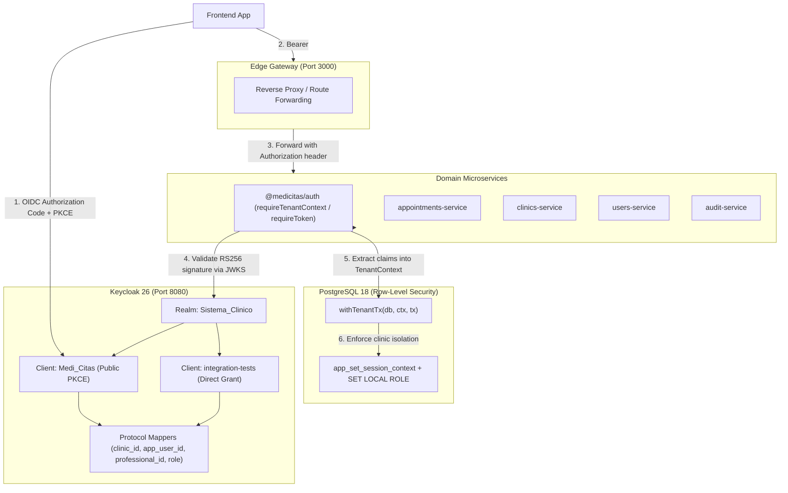

# Keycloak Multi-Tenant Identity Architecture

**English** · [Español](keycloak.es.md)

MediCitas uses Keycloak 26.7.0 in Compose, with one realm and custom OIDC claim
mappers. The frontend in the diagram is a possible OIDC client; no frontend app
is implemented in this repository.

---

## 1. Architectural Overview



---

## 2. Multi-Tenancy Design

MediCitas is a SaaS platform serving multiple clinics (tenants):
- Each clinic is identified by a UUID `clinic_id`.
- Tenant isolation is strictly enforced in PostgreSQL using **Row-Level Security (RLS)** via session parameters (`app.current_clinic_id`, `app.current_user_id`, `app.current_role`, `app.current_professional_id`).
- Current domain transactions switch to `medicitas_app`. SQL also defines actor
  profiles `db_admin`, `db_receptionist` and `db_professional`; the normal handlers
  do not select that role map. Relays use `medicitas_relay` on their source outbox.

### Why Single Realm + Custom Claims?
1. **Stateless Performance**: Microservices independently verify the JWT signature using Keycloak's public JWKS endpoint (`/realms/Sistema_Clinico/protocol/openid-connect/certs`). No database queries are required during token verification.
2. **Administration**: One realm keeps roles, clients and mappers in one configuration.
   No per-tenant realm performance comparison was measured.
3. **Seamless Platform Administration**: A `platform_admin` (who has `clinic_id: null`) can manage clinics across the platform without needing complex cross-realm trust federation.

---

## 3. Token Claims Specification

When an access token is issued, Keycloak's protocol mappers inject the following claims:

| Claim | Type | Description | Required Roles |
| :--- | :--- | :--- | :--- |
| `sub` | `string` | Keycloak user UUID (`keycloak_sub` in `app_user`). | All |
| `preferred_username`| `string` | Username of the authenticated user. | All |
| `clinic_id` | `string (UUID)` | Identifier of the tenant clinic. `null` for `platform_admin`. | `clinic_admin`, `receptionist`, `professional` |
| `app_user_id` | `string (UUID)` | Domain user ID in `users_db` (`app_user.app_user_id`). | All |
| `role` | `string` | Primary domain role: `platform_admin`, `clinic_admin`, `receptionist`, `professional`. | All |
| `professional_id` | `string (UUID)` | Healthcare professional ID in `users_db` (`professional.professional_id`). | `professional` |
| `realm_access.roles`| `string[]` | Array of assigned Keycloak realm roles. | All |

### Sample decoded JWT payload (professional)

Illustrative IDs and expired timestamps; this is not a usable token.
```json
{
  "exp": 1731369600,
  "iat": 1731369300,
  "iss": "http://localhost:8080/realms/Sistema_Clinico",
  "aud": "Medi_Citas",
  "sub": "7a3e8b1c-5d2f-4e6a-9b1c-8d2e3f4a5b6c",
  "preferred_username": "dr.smith",
  "clinic_id": "0b6c2f3e-4d1a-4c8e-9f2b-7a1d3e5c9b01",
  "app_user_id": "7c1e4b2a-9d3f-4e6a-b8c5-2a1f6d9e3b04",
  "role": "professional",
  "professional_id": "fa8d9e2a-1c3b-4f5a-8e7d-9a0b1c2d3e4f",
  "realm_access": {
    "roles": ["professional", "user"]
  }
}
```

---

## 4. Consumption in Microservices (`@medicitas/auth`)

The shared library `@medicitas/auth` provides middleware and context extractors:

```typescript
import { requireTenantContext, extractTenantContext } from '@medicitas/auth';
import { withTenantTx, MEDICITAS_APP_ROLE } from '@medicitas/db';

// 1. As an Express middleware:
app.use('/appointments', requireTenantContext, async (req, res) => {
  // res.locals.tenant is typed as TenantContext
  const ctx = res.locals.tenant;
  // Use in database transactions
  await withTenantTx(db, ctx, async (tx) => {
    // queries isolated to ctx.clinicId
  }, { dbRoles: MEDICITAS_APP_ROLE });
});

// 2. Or resolving context from req.user:
const ctx = extractTenantContext(req);
```

### TenantContext Shape
```typescript
export interface TenantContext {
  clinicId: string | null;  // null only for platform_admin
  userId: string;           // app_user_id (UUID)
  role: 'platform_admin' | 'clinic_admin' | 'receptionist' | 'professional';
  professionalId?: string | null; // UUID for professional
}
```

---

## 5. Local Setup & Docker Compose

Prepare `.env` as in the root README. This subset starts identity, its user seed
and the databases; it does not start the application or Redis:

```bash
# Start Keycloak and databases
docker compose up -d keycloak keycloak-seed db_clinics db_users db_appointments db_logs
```

- **Administration Console**: `http://localhost:8080`
- **Realm**: `Sistema_Clinico`
- **Realm configuration file**: `keycloak/realm-export.json` (auto-imported on startup via `--import-realm`).
- **Demo users seed**: `keycloak/seed-users.json`, generated with the SQL seeds from [`database/seed/data.mjs`](../database/seed/data.mjs) (see [seed-data.md](seed-data.md)); loaded idempotently via `keycloak/seed-users.mjs` and the `keycloak-seed` service using Keycloak Partial Import.

### Required Environment Variables (.env)
```ini
KEYCLOAK_ADMIN_USERNAME=admin
KEYCLOAK_ADMIN_PASSWORD=admin_password
KEYCLOAK_PORT=8080
KEYCLOAK_INTERNAL_PORT=8080
KEYCLOAK_MANAGEMENT_PORT=9000

REALM_NAME=Sistema_Clinico
CLIENT_ID=Medi_Citas
KEYCLOAK_INTERNAL_URL=http://keycloak:8080
KEYCLOAK_ISSUER=http://localhost:8080/realms/Sistema_Clinico
KEYCLOAK_AUDIENCE=Medi_Citas
KEYCLOAK_TEST_CLIENT_ID=integration-tests
KEYCLOAK_TEST_PASSWORD=replace-with-local-test-password
KEYCLOAK_USER_ADMIN_SECRET=replace-with-local-client-secret
```

---

## 6. Testing

### Run Auth Unit & Multi-Tenant Tests
```bash
npm test -w packages/auth
```

These unit tests exercise token validation, roles and tenant claims using in-memory
RS256 keys and a mock JWKS server. They do not establish a real Keycloak login or
a complete Compose run.

The internal JWKS URL must be reachable from the service; the issuer must match
the URL that issued the token. RF1/RF2 use the separate confidential
`medicitas-user-admin` client, whose service account has `manage-users`.
The user seed uses Partial Import with `SKIP` by default, preserving existing users
and passwords. It does not update every existing account on restart.

JWT verification is local to the services after fetching keys: most routes do not
recheck the current user role/status in `users_db`. Logging out Keycloak sessions
does not make an already issued JWT fail signature/expiry validation. After a role
change obtain fresh tokens; immediate revocation across every route is unverified.
