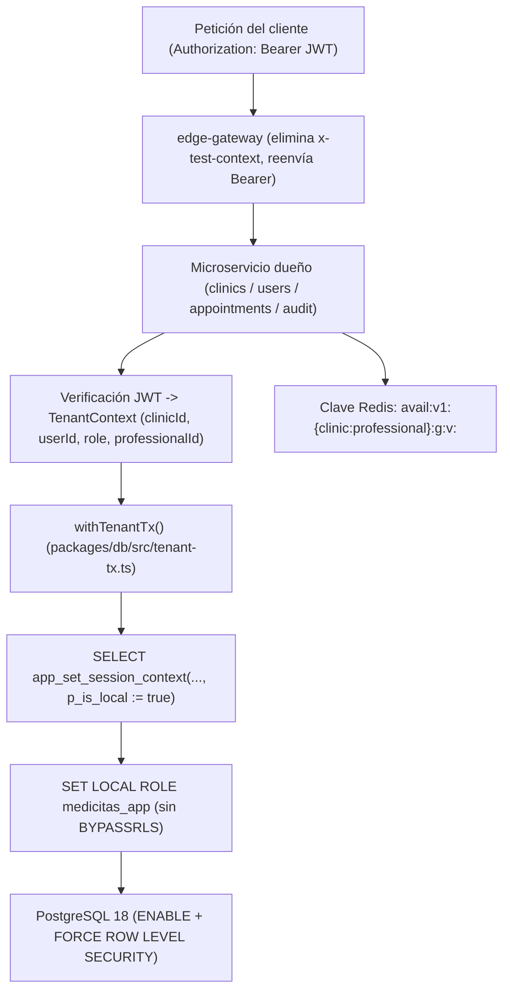

# Arquitectura Multi-Tenancy

[English](multitenancy.md) · **Español**

Cada clínica es un tenant en bases de servicio compartidas. Los claims verificados,
el contexto transaccional, RLS y las claves de caché por clínica sostienen el
aislamiento (I5). El gateway reenvía peticiones y los servicios de dominio las
autentican. Los manifiestos Kubernetes describen un despliegue opcional, no una
prueba de aislamiento ejecutada.

> Documentos relacionados: [Arquitectura de Bases de Datos y RLS](database.es.md) · [Comparación de Multi-Tenancy](database-comparison.es.md) · [Identidad con Keycloak](keycloak.es.md) · [Caché de Disponibilidad](cache.es.md)

---

## 1. Flujo de aislamiento de extremo a extremo



---

## 2. Garantías por capa

### 2.1 Capa de identidad y tokens (Keycloak OIDC)
- MediCitas delega la autenticación a Keycloak (realm `Sistema_Clinico`).
- Los JWT verificados transportan los claims de dominio sin confiar en IDs enviados por el cliente:
  - `app_user_id` (o `user_id`): UUID del usuario en `users_db.app_user`.
  - `clinic_id`: UUID de la clínica del usuario (`null` para `platform_admin`).
  - `role` / `realm_access.roles`: uno de `platform_admin`, `clinic_admin`, `receptionist`, `professional`.
  - `professional_id`: UUID del perfil profesional (obligatorio cuando `role = professional`; ausente para los demás roles).
- Los campos del cuerpo (`clinicId`), parámetros query o cabeceras (`x-clinic-id`, `x-role`) **nunca** pueden cambiar la clínica derivada del token verificado.

### 2.2 Edge Gateway y contexto de servicio (`packages/db/src/context.ts`)
- `edge-gateway` elimina cabeceras hop-by-hop y `x-test-context` antes de reenviar peticiones a los microservicios.
- Cada microservicio de dominio verifica Bearer en el arranque normal. Un contexto
  ausente o inválido devuelve 401. `assertTenantContext()` agrega validaciones
  antes de las transacciones del tenant:
  - **Fallo cerrado**: `platform_admin` debe tener `clinicId === null`; todos los roles de clínica (`clinic_admin`, `receptionist`, `professional`) requieren un UUID válido en `clinicId`; `professional` requiere un UUID válido en `professionalId`.
  - Cualquier combinación inválida lanza `InvalidTenantContextError` (`500`) antes de abrir conexión a PostgreSQL.

### 2.3 Contexto transaccional en base de datos (`packages/db/src/tenant-tx.ts`)
- Las consultas de dominio se ejecutan mediante `withTenantTx(db, ctx, fn, options)` dentro de una transacción PostgreSQL (`READ COMMITTED` por defecto):
  1. Ejecuta `SELECT app_set_session_context(clinicId, userId, role, professionalId, true)`, configurando `app.current_clinic_id`, `app.current_user_id`, `app.current_role` y `app.current_professional_id` con `is_local = true`.
  2. Opcionalmente aplica `statement_timeout` local a la transacción.
  3. Ejecuta `SET LOCAL ROLE medicitas_app` (sin `BYPASSRLS`).
- Los pools no conservan esos ajustes locales después del commit o rollback.
  PgBouncer no está desplegado aquí; las pruebas reutilizan una conexión para
  comprobar la limpieza del contexto.

### 2.4 Row-Level Security en PostgreSQL 18 y claves preparadas para sharding
- **Estrategia elegida**: MediCitas utiliza **Base compartida + columna discriminadora (`clinic_id`) + RLS de PostgreSQL** (ver [database-comparison.es.md](database-comparison.es.md)).
- **Aplicación en el motor**: Todas las tablas de dominio tienen activados `ENABLE ROW LEVEL SECURITY` y `FORCE ROW LEVEL SECURITY`:
  - `clinic_id = app_current_clinic_id()` filtra `SELECT`, `INSERT`, `UPDATE` y `DELETE` directamente en PostgreSQL.
  - Sin variables de sesión inicializadas, `app_current_clinic_id()` devuelve `NULL` y los predicados evalúan a `FALSE` (**denegación por defecto**).
  - Políticas por rol restringen aún más el acceso dentro de la clínica: por ejemplo, `clinical_note` solo es accesible para el profesional dueño de la cita (`professional_id = app_current_professional_id()`), y `audit_log` solo es visible para `clinic_admin` de esa clínica (`append-only` para `medicitas_app`).
- **Claves compuestas por tenant**: La mayoría de las llaves por tenant y las exclusiones incluyen `clinic_id`. `app_user` y los catálogos globales son excepciones. Particionamiento y sharding quedan pendientes.
- **Respuestas entre clínicas**: Consultar un UUID existente de otra clínica devuelve `404 not_found` (o `[]` en historial) sin revelar su existencia.

### 2.5 Aislamiento en caché Redis (`services/appointments-service`)
- Las claves de disponibilidad incluyen explícitamente `clinic` junto a `professional`:
  ```text
  avail:v1:{clinic:professional}:g<gen>:v<ver>:<date>
  ```
- Tanto los contadores de versión (`gen` y `ver`) como los bloques cacheados quedan aislados por clínica y profesional.

### 2.6 Relays de Outbox (`users_db`, `appointments_db` -> `logs_db`)
- Las lecturas/escrituras exitosas de notas y las escrituras de contacto encolan
  `AuditRecorded` con `clinic_id` en la misma transacción. No se audita toda mutación de clínica.
- El relay (`medicitas_relay`) toma eventos pendientes con `FOR UPDATE SKIP LOCKED` y los inserta en `logs_db.audit_log` como `medicitas_app` usando el `clinic_id` propio de cada evento en el contexto de sesión.

### 2.7 Aislamiento de infraestructura en Kubernetes (`deploy/`)
- **Base de datos por microservicio**: Cuatro StatefulSets y PVCs independientes (`db-clinics`, `db-users`, `db-appointments`, `db-logs`), con reglas declaradas para su servicio dueño y el relay de auditoría cuando aplica.
- Las [NetworkPolicies](../deploy/k8s/base/network-policies.yaml) declaran ingress
  denegado por defecto y flujos permitidos. Requieren un plugin de red que las
  implemente; los scripts de Kind no instalan ni verifican esa capacidad. Las reglas de Keycloak
  y gateway permiten cualquier origen en sus puertos. Cada tenant comparte pods
  y bases; estas reglas no prueban contención de un servicio comprometido.
