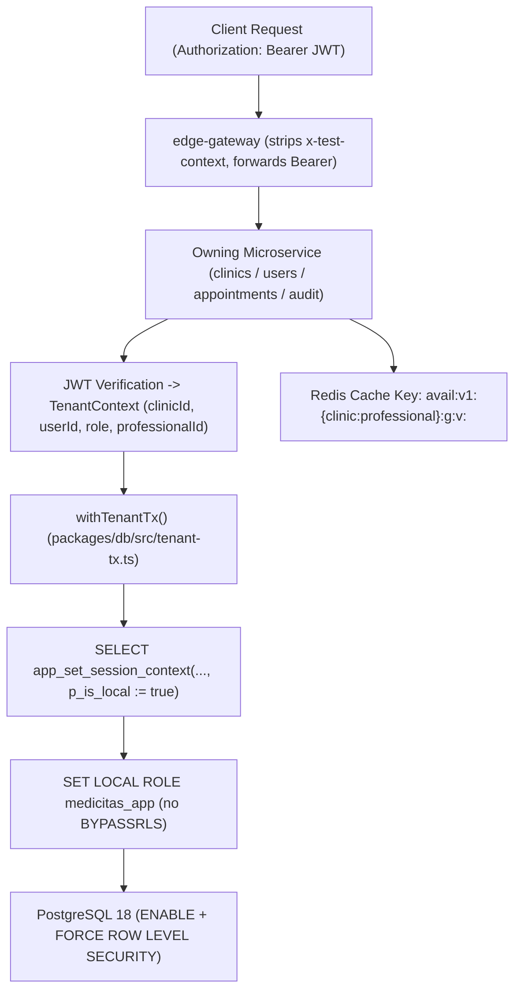

# Multi-Tenancy Architecture

**English** · [Español](multitenancy.es.md)

Each clinic is a tenant in shared service databases. Verified token claims,
transaction context, RLS and clinic-scoped cache keys support isolation (I5).
The gateway forwards requests; the domain services authenticate them. Kubernetes
manifests describe an optional deployment.

> Related docs: [Database & RLS Architecture](database.md) · [Multi-Tenancy Strategy Comparison](database-comparison.md) · [Keycloak Identity](keycloak.md) · [Availability Cache](cache.md)

---

## 1. End-to-End Tenant Isolation Flow



---

## 2. Layer-by-Layer Guarantees

### 2.1 Identity & Token Layer (Keycloak OIDC)
- MediCitas delegates authentication to Keycloak (`Sistema_Clinico` realm).
- Verified JWTs carry domain claims rather than trusting caller-supplied tenant IDs:
  - `app_user_id` (or `user_id`): UUID of the user in `users_db.app_user`.
  - `clinic_id`: UUID of the user's clinic (`null` for `platform_admin`).
  - `role` / `realm_access.roles`: one of `platform_admin`, `clinic_admin`, `receptionist`, `professional`.
  - `professional_id`: UUID of the professional profile (required when `role = professional`; absent for all other roles).
- Request body fields (`clinicId`), query parameters, or custom headers (`x-clinic-id`, `x-role`) **never** override the verified token's clinic.

### 2.2 Edge Gateway & Service Context (`packages/db/src/context.ts`)
- `edge-gateway` strips hop-by-hop headers and `x-test-context` before forwarding requests to upstream services.
- Every domain microservice validates Bearer at normal startup. Invalid/missing token
  context returns 401. `assertTenantContext()` adds checks before tenant transactions:
  - **Fail-closed checks**: `platform_admin` must have `clinicId === null`; every clinic role (`clinic_admin`, `receptionist`, `professional`) must have a valid UUID `clinicId`; `professional` must carry a valid UUID `professionalId`.
  - Any invalid combination throws `InvalidTenantContextError` (`500`) before touching PostgreSQL.

### 2.3 Transaction-Scoped Database Context (`packages/db/src/tenant-tx.ts`)
- Domain database operations run inside `withTenantTx(db, ctx, fn, options)`, which wraps work in a PostgreSQL transaction (`READ COMMITTED` by default):
  1. Executes `SELECT app_set_session_context(clinicId, userId, role, professionalId, true)` — setting `app.current_clinic_id`, `app.current_user_id`, `app.current_role`, and `app.current_professional_id` with `is_local = true`.
  2. Optionally sets a transaction-local `statement_timeout`.
  3. Runs `SET LOCAL ROLE medicitas_app` in current handlers. A role map is supported by the library.
- Because every GUC and `SET LOCAL ROLE` exists only for the active transaction, pooled connections do not retain those transaction-local settings after commit or rollback. PgBouncer
  is not deployed here; the tests reuse a connection to check cleanup.

### 2.4 PostgreSQL 18 Row-Level Security & Shard-Ready Keys
- **Strategy choice**: MediCitas uses **Shared Database + Discriminator Column (`clinic_id`) + PostgreSQL RLS** (see [database-comparison.md](database-comparison.md) for the tradeoff analysis vs. Schema/Database-per-Tenant).
- **Engine enforcement**: Tenant tables enable both `ENABLE ROW LEVEL SECURITY` and `FORCE ROW LEVEL SECURITY`:
  - `clinic_id = app_current_clinic_id()` filters `SELECT`, `INSERT`, `UPDATE`, and `DELETE` at the engine level.
  - Missing session GUCs evaluate `app_current_clinic_id()` to `NULL`, so predicates return `FALSE` (**deny by default**).
  - Fine-grained actor policies add extra restrictions on top of `clinic_id`: for example, `clinical_note` is restricted exclusively to the owning professional (`professional_id = app_current_professional_id()`), and `audit_log` is restricted to `clinic_admin` for their clinic (`append-only` via `medicitas_app` grants).
- **Composite tenant keys**: Most tenant keys and the overlap constraints include `clinic_id`. `app_user` and global catalogs are exceptions. Partitioning and sharding remain future work.
- **Cross-tenant responses**: Accessing a valid UUID that belongs to another clinic returns `404 not_found` (or `[]` on scoped queries like patient history when no visible rows match) instead of leaking existence.

### 2.5 Redis Cache Isolation (`services/appointments-service`)
- Availability keys are explicitly partitioned by `{clinic:professional}` hash tags:
  ```text
  avail:v1:{clinic:professional}:g<gen>:v<ver>:<date>
  ```
- Version counters (`gen` and `ver`) and cached day slots include the `clinic` ID so clinics cannot collide or read another tenant's availability snapshots.

### 2.6 Outbox Relays (`users_db`, `appointments_db` -> `logs_db`)
- Successful note reads/writes and patient contact writes queue `AuditRecorded` with
  `clinic_id` in the same transaction. This does not audit every clinic mutation.
- Background relays run as `medicitas_relay` (`FOR UPDATE SKIP LOCKED`) to claim pending events across clinics, then write each `audit_log` row into `logs_db` under `medicitas_app` using **that event's own `clinic_id`** in session context.

### 2.7 Kubernetes Infrastructure Isolation (`deploy/`)
- **Database-per-Service**: Four dedicated PostgreSQL 18 StatefulSets and PVCs (`db-clinics`, `db-users`, `db-appointments`, `db-logs`), with declared access rules for their owning service and, where needed, the audit relay.
- [NetworkPolicies](../deploy/k8s/base/network-policies.yaml) declare default-deny
  ingress and selected flows. Enforcement requires a network plugin that implements
  NetworkPolicy; the Kind deployment scripts do not install or verify that capability. Keycloak and gateway
  ingress rules permit any source on their listed ports. No tenant has its own pod
  or database, and these policies do not prove containment of a compromised service.
