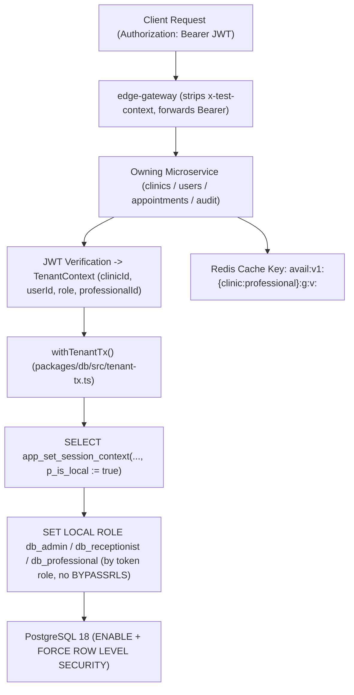

# Multi-Tenancy Architecture

**English** · [Español](multitenancy.es.md)

MediCitas is a multi-tenant clinical platform where every clinic operates as an isolated tenant within shared application and database runtimes. Tenant isolation is enforced as **defense in depth** across identity tokens, API routing, application transactions, PostgreSQL Row-Level Security (RLS), Redis caching, asynchronous relays, and Kubernetes network/database boundaries (**Invariant I5**).

> Related docs: [Database & RLS Architecture](database.md) · [Multi-Tenancy Strategy Comparison](database-comparison.md) · [Keycloak Identity](keycloak.md) · [Availability Cache](cache.md)

---

## 1. End-to-End Tenant Isolation Flow



---

## 2. Layer-by-Layer Guarantees

### 2.1 Identity & Token Layer (Keycloak OIDC)
- MediCitas delegates authentication to Keycloak (`Sistema_Clinico` realm).
- Verified JWTs carry domain claims rather than trusting caller-supplied tenant IDs:
  - `app_user_id` (or `user_id`): UUID of the user in `users_db.app_user`.
  - `clinic_id`: UUID of the user's clinic (`null` for `platform_admin`).
  - `role` / `realm_access.roles`: one of `platform_admin`, `clinic_admin`, `receptionist`, `professional`.
  - `professional_id`: UUID of the professional profile (required when `role = professional`; absent for all other roles).
- Request body fields (`clinicId`), query parameters, or custom headers (`x-clinic-id`, `x-role`) **never** override the verified token's clinic.

### 2.2 Edge Gateway & Service Context (`packages/db/src/context.ts`)
- `edge-gateway` strips hop-by-hop headers and `x-test-context` before forwarding requests to upstream services.
- Every microservice validates the Bearer token independently at runtime and builds a `TenantContext` validated by `assertTenantContext()`:
  - **Fail-closed checks**: `platform_admin` must have `clinicId === null`; every clinic role (`clinic_admin`, `receptionist`, `professional`) must have a valid UUID `clinicId`; `professional` must carry a valid UUID `professionalId`.
  - Any invalid combination throws `InvalidTenantContextError` (`500`) before touching PostgreSQL.

### 2.3 Transaction-Scoped Database Context (`packages/db/src/tenant-tx.ts`)
- Every database operation runs inside `withTenantTx(db, ctx, fn, options)`, which wraps work in a PostgreSQL transaction (`READ COMMITTED` by default):
  1. Executes `SELECT app_set_session_context(clinicId, userId, role, professionalId, true)` — setting `app.current_clinic_id`, `app.current_user_id`, `app.current_role`, and `app.current_professional_id` with `is_local = true`.
  2. Optionally sets a transaction-local `statement_timeout`.
  3. Runs `SET LOCAL ROLE` with the database role of the actor (`MEDICITAS_DB_ROLES`: `db_admin`, `db_receptionist` or `db_professional`, none with `BYPASSRLS`); see [database.md](database.md#least-privilege-database-roles).
- Because every GUC and `SET LOCAL ROLE` exists only for the active transaction, pooled connections (including transaction-mode PgBouncer) never leak a previous tenant's context to the next request.

### 2.4 PostgreSQL 18 Row-Level Security & Shard-Ready Keys
- **Strategy choice**: MediCitas uses **Shared Database + Discriminator Column (`clinic_id`) + PostgreSQL RLS** (see [database-comparison.md](database-comparison.md) for the tradeoff analysis vs. Schema/Database-per-Tenant).
- **Engine enforcement**: Tenant tables enable both `ENABLE ROW LEVEL SECURITY` and `FORCE ROW LEVEL SECURITY`:
  - `clinic_id = app_current_clinic_id()` filters `SELECT`, `INSERT`, `UPDATE`, and `DELETE` at the engine level.
  - Missing session GUCs evaluate `app_current_clinic_id()` to `NULL`, so predicates return `FALSE` (**deny by default**).
  - Fine-grained actor policies add extra restrictions on top of `clinic_id`: for example, `clinical_note` is restricted exclusively to the owning professional (`professional_id = app_current_professional_id()`), and `audit_log` is restricted to `clinic_admin` for their clinic (`append-only` via `medicitas_app` grants).
- **Composite tenant keys**: Primary keys, intra-database foreign keys, unique constraints, `EXCLUDE USING gist` overlap constraints (`appointment`, `working_hours`), and composite B-tree indexes lead with `clinic_id` so the schema stays ready for partitioning or sharding by `clinic_id`.
- **Cross-tenant responses**: Accessing a valid UUID that belongs to another clinic returns `404 not_found` (or `[]` on scoped queries like patient history when no visible rows match) instead of leaking existence.

### 2.5 Redis Cache Isolation (`services/appointments-service`)
- Availability keys are explicitly partitioned by `{clinic:professional}` hash tags:
  ```text
  avail:v1:{clinic:professional}:g<gen>:v<ver>:<date>
  ```
- Version counters (`gen` and `ver`) and cached day slots include the `clinic` ID so clinics cannot collide or read another tenant's availability snapshots.

### 2.6 Outbox Relays (`users_db`, `appointments_db` -> `logs_db`)
- Each clinic mutation producing an audit event writes `AuditRecorded` (alongside `clinic_id`) into its service database `outbox` table inside the same tenant transaction.
- Background relays run as `medicitas_relay` (`FOR UPDATE SKIP LOCKED`) to claim pending events across clinics, then write each `audit_log` row into `logs_db` under `medicitas_app` using **that event's own `clinic_id`** in session context.

### 2.7 Kubernetes Infrastructure Isolation (`deploy/`)
- **Database-per-Service**: Four dedicated PostgreSQL 18 StatefulSets and PVCs (`db-clinics`, `db-users`, `db-appointments`, `db-logs`), each accessible only by its owning microservice (and `audit-service` relay where required).
- **NetworkPolicies**: [network-policies.yaml](../deploy/k8s/base/network-policies.yaml) enforces default-deny ingress inside the `medicitas` namespace so compromised or unauthorized pods cannot reach other databases or internal services directly.
